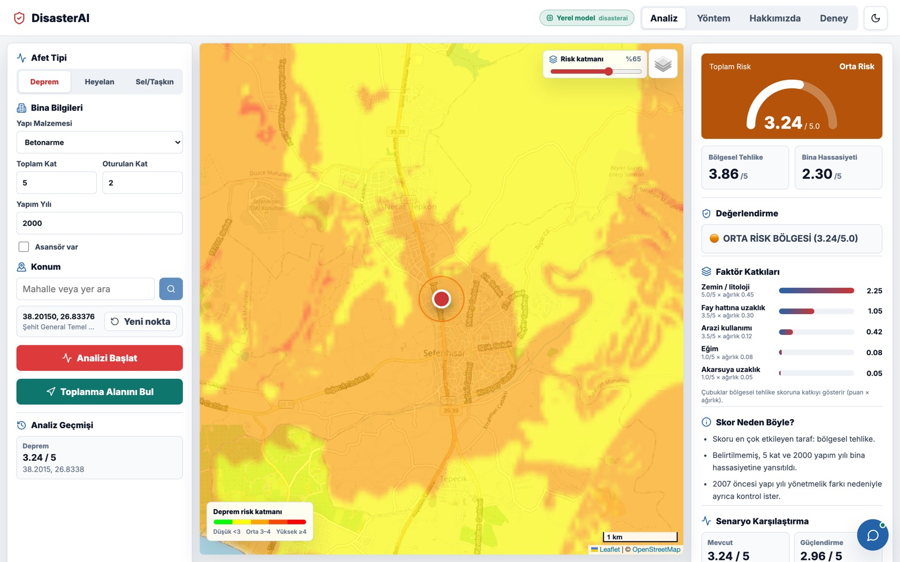
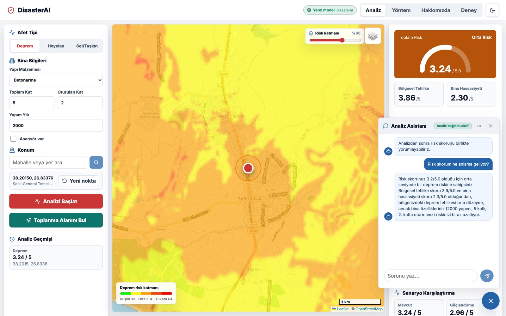

# DisasterAI

**GIS-based multi-hazard disaster risk analysis, explained in plain language by a fine-tuned local LLM.**

A resident picks a point on the map and describes their building. DisasterAI computes an earthquake, landslide or flood risk score from GIS layers, shows why the score is what it is, routes them on foot to the nearest assembly area, and lets them ask follow-up questions to an assistant. The assistant can run on Gemini or fully offline on a Turkish Llama 8B model I fine-tuned with QLoRA.

Graduation project, Management Information Systems, Pamukkale University (2026). **Supported by TÜBİTAK 2209-A** (Undergraduate Research Projects Support Programme). Study area: Seferihisar, İzmir.



## How it works

The risk score is calculated, not generated. The language model only explains a result that the GIS engine has already produced.

```
location + building info
        │
        ▼
 GIS engine (weighted overlay)          building vulnerability
 fault distance · lithology · slope  +  material · year · floors ·
 land use · distance to rivers          floor lived on · elevator
        │                                       │
        └──────────────► total risk score ◄─────┘
                               │
              ┌────────────────┼─────────────────┐
              ▼                ▼                 ▼
        "Why this score?"  walking route to   assistant (Gemini or
        factor breakdown   assembly area      local fine-tuned model)
```

**Weighted overlay with literature-based weights.** Each hazard combines reclassified GIS layers (1–5) with factor weights. The first version gave fault distance a weight of 0.50 for earthquakes; published Turkish AHP studies put it at 0.07–0.15. I replaced the weights with values in the middle of the ranges reported by five studies (consistency ratios 0.023–0.080) and measured how much the risk map changed using Cohen's kappa across the three risk classes. See [`outputs/agirlik_duyarlilik_analizi.md`](outputs/agirlik_duyarlilik_analizi.md).

| Earthquake factor | Weight |
| --- | --- |
| Lithology | 0.45 |
| Distance to fault | 0.30 |
| Land use | 0.12 |
| Slope | 0.08 |
| Distance to rivers | 0.05 |

## The fine-tuned model

| | |
| --- | --- |
| Base model | `ytu-ce-cosmos/Turkish-Llama-8b-Instruct-v0.1` |
| Method | QLoRA (r=16, α=32), 1 epoch, trained on Kaggle |
| Training data | ~2,500 examples generated from the GIS engine's own outputs |
| Serving | Quantised to GGUF Q4_K_M and served locally with Ollama |

Evaluated on 40 held-out cases ([`outputs/model_degerlendirme`](outputs/model_degerlendirme)):

| Metric | Result |
| --- | --- |
| Answers with no invented numbers | **97.5%** (39/40) |
| Invented numbers among all numbers produced | **0.3%** (1/390) |
| Answers that state the composite risk score | 87.5% (35/40) |
| Outdated safety advice | 0/40 |
| Memorisation check: 30+ word sequences copied from training data | **none** |

The memorisation check compares every generated text with the 2,014 training texts using 8-word sequence overlap (mean 15.4%, which is in line with fixed domain phrasing) and with the teacher model's reference answer for the same input (mean similarity 19.4%).



## Tone of risk communication

The same result can be told in different ways. [`src/risk_communication.py`](src/risk_communication.py) defines communication tones (for example a calming tone that does not downplay the risk) and picks one from the user's context. [`src/deney.py`](src/deney.py) and the **Experiment** tab run a three-arm, between-subjects user study: a deterministic technical report with no LLM, the raw LLM output, and the tone-managed output.

## Features

- Earthquake, landslide and flood/inundation risk for any point in the study area
- Building vulnerability from material, construction year, number of floors, floor lived on and elevator
- Risk layer on the map with adjustable opacity
- "Why this score?" factor breakdown
- Scenario comparison (for example, the score after retrofitting)
- Nearest assembly area and walking route with distance and time (OSRM)
- Analysis history, PDF report, light and dark theme
- Assistant on Gemini 2.5 Flash or a local model, switched with one environment variable

## Tech stack

**Backend:** Python, FastAPI, GeoPandas, Rasterio, Shapely, PyProj, NumPy, pandas, LangChain
**Frontend:** React, Vite, Leaflet / React Leaflet
**ML:** Hugging Face Transformers, PEFT (QLoRA), bitsandbytes, llama.cpp (GGUF), Ollama
**Data:** OpenStreetMap, OSRM, Copernicus DEM (slope), GIS layers for faults, lithology, rivers and land use

## Project structure

```text
backend/main.py              FastAPI entry point
src/
  disaster_risk_v4.py        analysis engine and API endpoints
  gis_engine.py              raster/vector sampling and weighted overlay
  reclass_tables.py          reclassification tables (1–5) per factor
  risk_communication.py      communication tones and tone selection
  deney.py                   user-study infrastructure
frontend/src/                React app (App.jsx, ExperimentPanel.jsx)
data/                        GIS layers for Seferihisar, slope raster
tools/                       QLoRA training notebooks, evaluation and analysis scripts
outputs/                     risk maps, weight sensitivity analysis, model evaluation
```

## Run it locally

Requirements: Python 3.10+, Node.js 18+.

```bash
python3 -m venv venv && source venv/bin/activate
pip install -r requirements.txt
cd frontend && npm install && cd ..
```

Backend (terminal 1):

```bash
python -m uvicorn backend.main:app --host 127.0.0.1 --port 8514
```

Frontend (terminal 2):

```bash
cd frontend && npm run dev
```

Open `http://127.0.0.1:5173`.

**Assistant provider.** By default the assistant uses Gemini: put `GOOGLE_API_KEY=...` in a `.env` file at the project root. To run it offline on the fine-tuned model, build it with Ollama (`ollama create disasterai -f tools/Modelfile.disasterai`, after pointing `FROM` at your GGUF file) and start the backend with `MODEL_SAGLAYICI=yerel`. Risk analysis, the map and routing work without any LLM.

**Slope raster.** `data/raster/egim.tif` is included. To regenerate it, download the Copernicus DEM tiles N38 E026 and N38 E027 into `data/raster/` and run `tools/egim_uret.py`.

## Author

**Ayşe Çetin** · Management Information Systems, Pamukkale University
[Portfolio](https://aysecetin.github.io) · [LinkedIn](https://www.linkedin.com/in/ayseecetin/)
